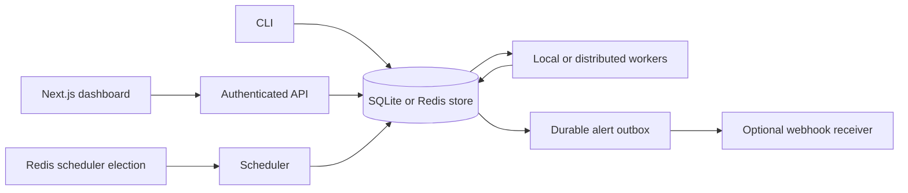

# aqs-schedular

A self-hosted Go job scheduler with cron, retries, SQLite or shared Redis storage, distributed workers, a durable webhook outbox, retention, bounded pagination, and a Next.js operations dashboard.

## Quickstart

```sh
go build ./cmd/sched
./sched daemon
```

In another terminal, add a job and inspect its output:

```sh
./sched add --schedule "*/1 * * * *" --name "ping" --timeout 10 -- echo hello
./sched list
./sched logs <job-id>
```

The database defaults to `aqs.db` in the current directory. Set `AQS_DB` to change its location. The daemon emits JSON logs; CLI commands print text output. Redis is optional; without `AQS_REDIS_URL`, the daemon runs in local single-node mode.

For a one-shot job, use an RFC3339 timestamp:

```sh
./sched add --at "2026-10-01T15:00:00Z" --name "one-shot" -- echo done
```

Commands are run through `sh -c`. Put `--` between scheduler options and the command when needed to separate command arguments from scheduler flags. Quote the complete shell command as one argument when it contains pipes, redirection, or its own quoting, for example `sched add --schedule '@daily' --name report -- 'date; echo done'`.

## Architecture



The scheduler checks for due jobs once per second, stores pending runs, and advances `next_run_at` atomically. The executor claims pending work, captures output, and persists results. SQLite is the default local store; `AQS_STORE=redis` uses shared Redis data and leased, fenced worker claims. Terminal runs enqueue alert outbox rows; a background delivery worker claims and retries them independently of execution.

## Data model

A `jobs` row is the durable definition of a recurring or one-shot task. A `runs` row is one scheduled or manually triggered execution attempt. Keeping these separate preserves the job configuration while retaining each run's schedule time, status, exit code, duration, and error. Retries create additional run rows, and `run_logs` stores ordered stdout and stderr chunks for each run. `alert_outbox` stores delivery state (attempts, lease, retry time, delivered/abandoned timestamps) for terminal run notifications.

The schema is versioned and migrated at daemon startup (current version 2). Deleting a job deletes its runs, logs, and alert outbox rows.

## Schedule syntax

The parser accepts five-field cron expressions with `*`, ranges, lists, and steps, plus month and weekday names. Supported aliases are `@hourly`, `@daily`, `@weekly`, `@monthly`, `@yearly`, and `@annually`. `@every <duration>` accepts Go duration strings of at least one second. One-shot schedules are stored as `once:<RFC3339>`.

When day-of-month and day-of-week are both restricted, either match is sufficient, following standard cron OR behavior. Schedules use the location of the time passed to the parser; the daemon currently uses the host's local time for cron calculations. On a DST spring-forward gap, a nonexistent local time is skipped. On a fall-back repeated hour, the first occurrence is used.

## Retries and process execution

The executor defaults to four workers. Commands run in their own process group, so a timeout kills the shell and its child processes. Stdout and stderr are persisted in chunks of up to 1 KiB.

`--max-retries` is the attempt limit used by the stored run attempt number: attempts below that limit can create a retry; reaching the limit marks the run dead. Backoff may be `exponential`, `linear`, or `none`. Exponential backoff starts at one second and adds up to one second of jitter. After an ungraceful daemon exit, runs left in `running` are marked interrupted and follow the same retry limit.

## Distributed mode

All participating CLI, API, scheduler, and worker processes must use the same Redis URL and namespace:

```sh
export AQS_STORE=redis
export AQS_REDIS_URL=redis://localhost:6379/0
export AQS_REDIS_PREFIX=aqs-scheduler
./sched scheduler
```

On worker hosts, use the same settings and run `./sched worker --concurrency 4`. Alternatively, `./sched daemon` runs a worker pool on every instance while electing one scheduler. Workers continue operating when scheduler leadership changes.

Worker claims have unique owner tokens, renewed leases, fenced log/result writes, and atomic result-plus-retry persistence. Expired worker leases requeue the run and preserve its existing logs; this redelivery is independent of `max_retries`, so execution remains **at-least-once** and external side effects can repeat after a crash. Jobs must be idempotent. Worker hosts need the commands, credentials, and files required by their jobs. No sandbox or per-job host routing is provided.

The scheduler leader renews its lease during graceful shutdown while a local daemon drains in-flight runs. This prevents a second instance from scheduling duplicate work during the drain window. Leadership loss cancels the callback and re-enters the election loop rather than exiting the process.

`AQS_CONCURRENCY` defaults to 4. `AQS_WORKER_LEASE_TTL` and `AQS_LEADER_TTL` default to 15 seconds (minimum 3 seconds); `AQS_LEADER_RETRY` defaults to 2 seconds. `AQS_LEADER_KEY` defaults to `<AQS_REDIS_PREFIX>:leader` in distributed mode. Keep host clocks and timezones synchronized.

Redis is now the data store in this mode, not merely a lock service. Enable AOF persistence, configure backups and a non-evicting policy, and restrict access with authentication/TLS. Durability depends on your Redis configuration; `appendfsync everysec` can lose recent writes. This implementation targets one Redis primary, not Redis Cluster, and scans stored collections rather than optimizing large queues. Use `sched migrate` to copy an existing SQLite database into Redis; it is idempotent and requeues runs that were mid-flight.

Legacy SQLite-plus-Redis election remains an active/passive local mode; do not use shared SQLite files across hosts or network filesystems.

## Management API and dashboard

Set a strong private `AQS_API_TOKEN`, then run `./sched serve --listen 127.0.0.1:8080`. This serves the API only; run a daemon or workers separately with the same store configuration. To serve the API alongside a daemon, set `AQS_API_LISTEN=127.0.0.1:8080`.

The API supports job CRUD, pause/resume/manual runs, run history, logs, retry, and status counts. `/api/*` requires `Authorization: Bearer <token>`; `/healthz` returns a minimal unauthenticated response. Treat this API as administrative shell-execution access. Keep it on loopback or a private network and use TLS when exposed remotely.

Collections are bounded and paginated. Jobs default to 200 rows (`limit` up to 1000) with `offset`; runs default to 50 rows (`limit` up to 500) with `offset`; logs default to the last 1000 chunks (`limit` up to 10000) and accept `before=<seq>` or `after=<seq>` cursors, but not both. Responses remain bare JSON arrays, so existing clients continue to work. The dashboard exposes load-more controls for jobs and runs and load-earlier for logs.

Configure `dashboard/.env.local` with `AQS_API_URL=http://127.0.0.1:8080`, the same `AQS_API_TOKEN`, and `DASHBOARD_PASSWORD`. The token stays in the Next.js server and is not sent to the browser. The optional dashboard Basic-auth username is `admin`; set a password before any remote access.

```sh
npm --prefix dashboard ci
npm --prefix dashboard run dev
```

The dashboard binds to `127.0.0.1:3000`. It includes job creation, filtering, pause/resume/delete, manual triggers, run history, retry, and polling/follow logs. For production, run `npm --prefix dashboard run build` then `npm --prefix dashboard start`.

## Webhook alerts

Set `AQS_ALERT_WEBHOOK_URL` on worker/daemon processes to receive dead-run alerts. `AQS_ALERT_STATUSES` can select `dead`, `failed`, and/or `succeeded`; the default is `dead`. `AQS_ALERT_SECRET` enables an HMAC-SHA256 `X-AQS-Signature` over the JSON body. `X-AQS-Event-ID` is stable for a run/status so receivers can deduplicate deliveries.

Payloads include job/run IDs, job name, status, attempt, error, duration, and exit code—not commands or logs. Delivery is durable: terminal runs enqueue an outbox row before any HTTP attempt, and a leased background worker retries transient failures with exponential backoff. The default limit is eight delivery cycles (`AQS_ALERT_MAX_ATTEMPTS`), starting at two seconds (`AQS_ALERT_RETRY`) up to ten minutes; exhausted alerts are abandoned. A periodic reconciliation sweep enqueues terminal runs that lack an outbox row, covering a crash between result persistence and enqueue.

Delivery is at-least-once. `X-AQS-Event-ID` is stable for a run/status so receivers can deduplicate. Redirects are refused, and each request is bounded to five seconds with the existing per-cycle retry budget. `AQS_ALERT_LEASE` controls the claim lease (default 30s) and `AQS_ALERT_SWEEP_LOOKBACK` controls reconciliation history (default 24h). Failed delivery never changes the run result.

## Design decisions

- **Stored `next_run_at`:** due work is indexed and queried without recalculating every job on each scheduler tick. Updating it alongside run creation prevents a tick from queuing a duplicate run after a restart.
- **Missed runs are recorded:** on startup, if a job's due time is more than one schedule interval in the past, the scheduler records a `missed` run rather than silently discarding that schedule occurrence. A due time within one interval is run normally.
- **Interrupted runs:** on startup, stale `running` rows become failed or dead with an interruption error; eligible attempts are retried. A command may have completed immediately before a crash but not yet persisted its result, so execution is at-least-once rather than exactly-once.
- **SQLite:** a single-node scheduler needs durable storage without a separate service. SQLite provides transactional run creation, restart recovery, and a simple deployment footprint; a later distributed version can replace coordination and storage boundaries.
- **Leader lease during drain:** renewal runs on a background context while the leader callback drains, so shutdown cannot expire the lease and let another instance schedule the same work. Leadership-loss cancellation is treated as failover, not a fatal service error.
- **Durable alert outbox:** enqueueing before delivery decouples notification from job execution, survives restarts, and keeps webhook latency out of worker completion. Leases prevent concurrent delivery; stable event IDs make at-least-once delivery safe to deduplicate.
- **Bounded pagination:** collection endpoints default to bounded windows while retaining the existing bare-array contract. The dashboard requests only what it shows and offers explicit load-more/load-earlier controls.
- **Retention preserves undelivered alerts:** pruning deletes only terminal runs scheduled before the cutoff and never removes a run with a pending outbox row. Live states are rejected by validation.
- **Idempotent migration:** SQLite-to-Redis migration copies jobs before runs before logs, skips records already present, and requeues mid-flight runs because their worker lease does not exist in the target.
- **Standard-library CLI flags:** the command set is small and benefits from a dependency-free parser. Each subcommand owns its flags and validates its own arguments.

## CLI reference

```text
sched daemon [--concurrency 4] [--listen 127.0.0.1:8080]
sched scheduler
sched worker [--concurrency 4]
sched serve [--listen 127.0.0.1:8080]
sched add --schedule "*/5 * * * *" --name "ping" --timeout 10 -- curl https://example.com
sched add --at "2026-10-01T15:00:00Z" --name "one-shot" -- echo done
sched list [--status active|paused|dead]
sched logs <job-id> [--run <run-id>] [--follow]
sched run <job-id>
sched retry <run-id>
sched pause <job-id>
sched resume <job-id>
sched delete <job-id>
sched prune [--older-than 720h] [--status succeeded,failed,dead,missed] [--dry-run]
sched backup --output aqs-backup.db
sched migrate --from sqlite --db aqs.db --redis-url redis://localhost:6379/0 --prefix aqs-scheduler [--dry-run]
```

`run` creates a pending manual run; the daemon's workers execute it. `retry` creates a new pending attempt from a failed or dead run. `logs` selects the latest run unless `--run` is given. `AQS_DB` controls the SQLite file for both daemon and CLI.

`prune` deletes terminal run history older than a cutoff while preserving runs with undelivered alerts. Set `AQS_RETENTION` (for example `720h`) on a daemon to run the same prune hourly in the background. `backup` uses SQLite `VACUUM INTO` to create a consistent snapshot and refuses to overwrite an existing file. `migrate` is idempotent and can be rerun to resume a partial copy.

## Operations

**SQLite backup and restore.** Stop or pause the daemon, then run `sched backup --output /backups/aqs-$(date +%Y%m%d).db`. The command uses `VACUUM INTO`, producing a consistent snapshot without copying WAL files. To restore, stop every process using the database, move the snapshot into place as `AQS_DB`, and start the daemon; migrations run automatically. Never copy a live SQLite file without a snapshot because WAL contents may be missing.

**Redis persistence.** Enable AOF with an fsync policy appropriate to your loss tolerance, configure periodic snapshots or managed backups, set `maxmemory-policy noeviction`, and require authentication/TLS. Back up the entire configured prefix. `sched migrate` is for one-time SQLite-to-Redis cutover, not a Redis backup tool.

**Retention.** Run `sched prune --older-than 720h --dry-run` first, then schedule the command with cron/systemd or set `AQS_RETENTION=720h` on a daemon. Retention deletes runs, logs, and delivered/abandoned alert rows; pending alerts always preserve their runs.

**Alert delivery.** The outbox is part of the same store as jobs and runs. Delivery workers run on `daemon` and `worker` roles. If every worker is stopped, outbox rows wait; starting a worker resumes delivery. The reconciliation sweep looks back 24 hours by default, so alerts older than that are not reconstructed after a long outage.

## Development

```sh
go test -race ./...
go vet ./...
go test ./cmd/sched -run TestMultiProcessRedisSchedulerAndWorker -v
```

Frontend checks: `npm --prefix dashboard run typecheck`, `npm --prefix dashboard run lint`, `npm --prefix dashboard test`, and `npm --prefix dashboard run test:integration`. The dashboard integration test uses a mock backend; `scripts/e2e-dashboard.sh` starts the real Go API and a production Next.js build, then exercises create/list/delete through the authenticated dashboard proxy.

## Completion status

Shared Redis storage, leased distributed workers, authenticated REST management, the Next.js dashboard, signed webhook alerts, a durable alert outbox, leader-drain lease renewal, bounded pagination, retention, SQLite backup, and SQLite-to-Redis migration are implemented. Backend race/vet checks, frontend build/tests, a multi-process Redis scheduler/worker test, and a real-dashboard-to-real-API end-to-end check have passed.

Remaining production work is deployment-specific: validate against the Redis topology and persistence settings you will operate, run an alert receiver with your retry/deduplication policy, choose retention and backup windows, and front remote access with TLS and rate limiting. Horizontal scaling still targets one Redis primary; the store scans collections rather than providing a queue-sized index.
