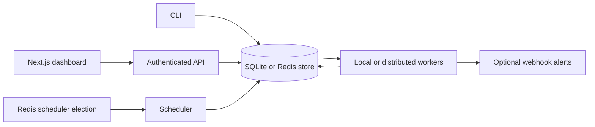

# aqs-schedular

A self-hosted Go job scheduler with cron, retries, SQLite or shared Redis storage, distributed workers, and a Next.js operations dashboard.

## Quickstart

```sh
go build ./cmd/sched
./sched daemon
```

In another terminal, add a job and inspect its output:

```sh
./sched add --schedule "*/1 * * * *" --name "ping" --timeout 10 -- sh -c 'echo hello'
./sched list
./sched logs <job-id>
```

The database defaults to `aqs.db` in the current directory. Set `AQS_DB` to change its location. The daemon emits JSON logs; CLI commands print text output. Redis is optional; without `AQS_REDIS_URL`, the daemon runs in local single-node mode.

For a one-shot job, use an RFC3339 timestamp:

```sh
./sched add --at "2026-10-01T15:00:00Z" --name "one-shot" -- echo done
```

Commands are run through `sh -c`. Put `--` between scheduler options and the command when needed to separate command arguments from scheduler flags.

## Architecture



The scheduler checks for due jobs once per second, stores pending runs, and advances `next_run_at` atomically. The executor claims pending work, captures output, and persists results. SQLite is the default local store; `AQS_STORE=redis` uses shared Redis data and leased, fenced worker claims.

## Data model

A `jobs` row is the durable definition of a recurring or one-shot task. A `runs` row is one scheduled or manually triggered execution attempt. Keeping these separate preserves the job configuration while retaining each run's schedule time, status, exit code, duration, and error. Retries create additional run rows, and `run_logs` stores ordered stdout and stderr chunks for each run.

The schema is versioned and migrated at daemon startup. Deleting a job deletes its runs and logs.

## Schedule syntax

The parser accepts five-field cron expressions with `*`, ranges, lists, and steps, plus month and weekday names. Supported aliases are `@hourly`, `@daily`, `@weekly`, `@monthly`, `@yearly`, and `@annually`. `@every <duration>` accepts Go duration strings of at least one second. One-shot schedules are stored as `once:<RFC3339>`.

When day-of-month and day-of-week are both restricted, either match is sufficient, following standard cron OR behavior. Schedules use the location of the time passed to the parser; the daemon currently uses the host's local time for cron calculations. On a DST spring-forward gap, a nonexistent local time is skipped. On a fall-back repeated hour, the first occurrence is used.

## Retries and process execution

The executor defaults to four workers. Commands run in their own process group, so a timeout kills the shell and its child processes. Stdout and stderr are persisted in chunks of up to 1 KiB.

`--max-retries` is the attempt limit used by the stored run attempt number: attempts below that limit can create a retry; reaching the limit marks the run dead. Backoff may be `exponential`, `linear`, or `none`. Exponential backoff starts at one second and adds up to one second of jitter. After an ungraceful daemon exit, runs left in `running` are marked interrupted and follow the same retry limit.

## Distributed mode

All participating CLI, API, scheduler, and worker processes must use the same Redis URL and namespace:

```sh
export AQS_STORE=redis
export AQS_REDIS_URL=redis://localhost:6379/0
export AQS_REDIS_PREFIX=aqs-scheduler
./sched scheduler
```

On worker hosts, use the same settings and run `./sched worker --concurrency 4`. Alternatively, `./sched daemon` runs a worker pool on every instance while electing one scheduler. Workers continue operating when scheduler leadership changes.

Worker claims have unique owner tokens, renewed leases, fenced log/result writes, and atomic result-plus-retry persistence. Expired worker leases requeue the run and preserve its existing logs. Execution remains **at-least-once**: external command side effects can repeat after a crash, so jobs must be idempotent. Worker hosts need the commands, credentials, and files required by their jobs. No sandbox or per-job host routing is provided.

`AQS_CONCURRENCY` defaults to 4. `AQS_WORKER_LEASE_TTL` and `AQS_LEADER_TTL` default to 15 seconds (minimum 3 seconds); `AQS_LEADER_RETRY` defaults to 2 seconds. `AQS_LEADER_KEY` defaults to `<AQS_REDIS_PREFIX>:leader` in distributed mode. Keep host clocks and timezones synchronized.

Redis is now the data store in this mode, not merely a lock service. Enable AOF persistence, configure backups and a non-evicting policy, and restrict access with authentication/TLS. Durability depends on your Redis configuration; `appendfsync everysec` can lose recent writes. This implementation targets one Redis primary, not Redis Cluster, and scans stored collections rather than optimizing large queues. Existing SQLite data is not migrated automatically.

Legacy SQLite-plus-Redis election remains an active/passive local mode; do not use shared SQLite files across hosts or network filesystems.

## Management API and dashboard

Set a strong private `AQS_API_TOKEN`, then run `./sched serve --listen 127.0.0.1:8080`. This serves the API only; run a daemon or workers separately with the same store configuration. To serve the API alongside a daemon, set `AQS_API_LISTEN=127.0.0.1:8080`.

The API supports job CRUD, pause/resume/manual runs, run history, logs, retry, and status counts. `/api/*` requires `Authorization: Bearer <token>`; `/healthz` returns a minimal unauthenticated response. Treat this API as administrative shell-execution access. Keep it on loopback or a private network and use TLS when exposed remotely.

Configure `dashboard/.env.local` with `AQS_API_URL=http://127.0.0.1:8080`, the same `AQS_API_TOKEN`, and `DASHBOARD_PASSWORD`. The token stays in the Next.js server and is not sent to the browser. The optional dashboard Basic-auth username is `admin`; set a password before any remote access.

```sh
npm --prefix dashboard ci
npm --prefix dashboard run dev
```

The dashboard binds to `127.0.0.1:3000`. It includes job creation, filtering, pause/resume/delete, manual triggers, run history, retry, and polling/follow logs. For production, run `npm --prefix dashboard run build` then `npm --prefix dashboard start`.

## Webhook alerts

Set `AQS_ALERT_WEBHOOK_URL` on worker/daemon processes to receive dead-run alerts. `AQS_ALERT_STATUSES` can select `dead`, `failed`, and/or `succeeded`; the default is `dead`. `AQS_ALERT_SECRET` enables an HMAC-SHA256 `X-AQS-Signature` over the JSON body. `X-AQS-Event-ID` is stable for a run/status so receivers can deduplicate deliveries.

Payloads include job/run IDs, job name, status, attempt, error, duration, and exit code—not commands or logs. Delivery is best effort, bounded to five seconds and three attempts for transient failures. Redirects are refused. There is no durable alert outbox yet; failed delivery is logged and does not alter the run result.

## Design decisions

- **Stored `next_run_at`:** due work is indexed and queried without recalculating every job on each scheduler tick. Updating it alongside run creation prevents a tick from queuing a duplicate run after a restart.
- **Missed runs are recorded:** on startup, if a job's due time is more than one schedule interval in the past, the scheduler records a `missed` run rather than silently discarding that schedule occurrence. A due time within one interval is run normally.
- **Interrupted runs:** on startup, stale `running` rows become failed or dead with an interruption error; eligible attempts are retried. A command may have completed immediately before a crash but not yet persisted its result, so execution is at-least-once rather than exactly-once.
- **SQLite:** a single-node scheduler needs durable storage without a separate service. SQLite provides transactional run creation, restart recovery, and a simple deployment footprint; a later distributed version can replace coordination and storage boundaries.
- **Standard-library CLI flags:** the command set is small and benefits from a dependency-free parser. Each subcommand owns its flags and validates its own arguments.

## CLI reference

```text
sched daemon [--concurrency 4] [--listen 127.0.0.1:8080]
sched scheduler
sched worker [--concurrency 4]
sched serve [--listen 127.0.0.1:8080]
sched add --schedule "*/5 * * * *" --name "ping" --timeout 10 -- curl https://example.com
sched add --at "2026-10-01T15:00:00Z" --name "one-shot" -- echo done
sched list [--status active|paused|dead]
sched logs <job-id> [--run <run-id>] [--follow]
sched run <job-id>
sched retry <run-id>
sched pause <job-id>
sched resume <job-id>
sched delete <job-id>
```

`run` creates a pending manual run; the daemon's workers execute it. `retry` creates a new pending attempt from a failed or dead run. `logs` selects the latest run unless `--run` is given. `AQS_DB` controls the SQLite file for both daemon and CLI.

## Development

```sh
go test -race ./...
go vet ./...
```

Frontend checks: `npm --prefix dashboard run typecheck`, `npm --prefix dashboard run lint`, `npm --prefix dashboard test`, and `npm --prefix dashboard run test:integration`.

## Next-session checkpoint

Shared Redis storage, leased distributed workers, authenticated REST management, the Next.js dashboard, and best-effort signed webhook alerts are implemented. Backend race/vet checks and frontend build/tests have passed.

Before a production deployment, finish live multi-process Redis and real-dashboard end-to-end testing, review legacy SQLite leadership renewal during graceful shutdown, and add an operational persistence/backup setup. Future hardening includes a durable alert outbox, pagination/retention, and a SQLite-to-Redis migration tool.
