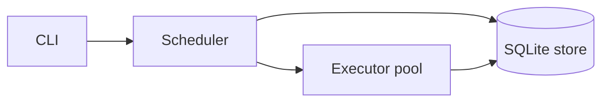

# aqs-schedular

A self-hosted job scheduler for cron jobs, retries, and run history, built on Go and SQLite.

## Quickstart

```sh
go build ./cmd/sched
./sched daemon
```

In another terminal, add a job and inspect its output:

```sh
./sched add --schedule "*/1 * * * *" --name "ping" --timeout 10 -- sh -c 'echo hello'
./sched list
./sched logs <job-id>
```

The database defaults to `aqs.db` in the current directory. Set `AQS_DB` to change its location. The daemon emits JSON logs; CLI commands print text output.

For a one-shot job, use an RFC3339 timestamp:

```sh
./sched add --at "2026-10-01T15:00:00Z" --name "one-shot" -- echo done
```

Commands are run through `sh -c`. Put `--` between scheduler options and the command when needed to separate command arguments from scheduler flags.

## Architecture



The scheduler checks for due jobs once per second, stores pending runs, and advances each job's `next_run_at` in the same SQLite transaction. The executor claims pending runs, starts shell commands, saves output in bounded chunks, and records the result. SQLite is the source of truth for both work and history.

## Data model

A `jobs` row is the durable definition of a recurring or one-shot task. A `runs` row is one scheduled or manually triggered execution attempt. Keeping these separate preserves the job configuration while retaining each run's schedule time, status, exit code, duration, and error. Retries create additional run rows, and `run_logs` stores ordered stdout and stderr chunks for each run.

The schema is versioned and migrated at daemon startup. Deleting a job deletes its runs and logs.

## Schedule syntax

The parser accepts five-field cron expressions with `*`, ranges, lists, and steps, plus month and weekday names. Supported aliases are `@hourly`, `@daily`, `@weekly`, `@monthly`, `@yearly`, and `@annually`. `@every <duration>` accepts Go duration strings of at least one second. One-shot schedules are stored as `once:<RFC3339>`.

When day-of-month and day-of-week are both restricted, either match is sufficient, following standard cron OR behavior. Schedules use the location of the time passed to the parser; the daemon currently uses the host's local time for cron calculations. On a DST spring-forward gap, a nonexistent local time is skipped. On a fall-back repeated hour, the first occurrence is used.

## Retries and process execution

The executor defaults to four workers. Commands run in their own process group, so a timeout kills the shell and its child processes. Stdout and stderr are persisted in chunks of up to 1 KiB.

`--max-retries` is the attempt limit used by the stored run attempt number: attempts below that limit can create a retry; reaching the limit marks the run dead. Backoff may be `exponential`, `linear`, or `none`. Exponential backoff starts at one second and adds up to one second of jitter. After an ungraceful daemon exit, runs left in `running` are marked interrupted and follow the same retry limit.

## Design decisions

- **Stored `next_run_at`:** due work is indexed and queried without recalculating every job on each scheduler tick. Updating it alongside run creation prevents a tick from queuing a duplicate run after a restart.
- **Missed runs are recorded:** on startup, if a job's due time is more than one schedule interval in the past, the scheduler records a `missed` run rather than silently discarding that schedule occurrence. A due time within one interval is run normally.
- **Interrupted runs:** on startup, stale `running` rows become failed or dead with an interruption error; eligible attempts are retried. A command may have completed immediately before a crash but not yet persisted its result, so execution is at-least-once rather than exactly-once.
- **SQLite:** a single-node scheduler needs durable storage without a separate service. SQLite provides transactional run creation, restart recovery, and a simple deployment footprint; a later distributed version can replace coordination and storage boundaries.
- **Standard-library CLI flags:** the command set is small and benefits from a dependency-free parser. Each subcommand owns its flags and validates its own arguments.

## CLI reference

```text
sched daemon
sched add --schedule "*/5 * * * *" --name "ping" --timeout 10 -- curl https://example.com
sched add --at "2026-10-01T15:00:00Z" --name "one-shot" -- echo done
sched list [--status active|paused|dead]
sched logs <job-id> [--run <run-id>] [--follow]
sched run <job-id>
sched retry <run-id>
sched pause <job-id>
sched resume <job-id>
sched delete <job-id>
```

`run` creates a pending manual run; the daemon's workers execute it. `retry` creates a new pending attempt from a failed or dead run. `logs` selects the latest run unless `--run` is given. `AQS_DB` controls the SQLite file for both daemon and CLI.

## Development

```sh
go test -race ./...
go vet ./...
```

## Roadmap

- Redis coordination and leader election
- Distributed workers
- Next.js dashboard
- Alerts and operational notifications
